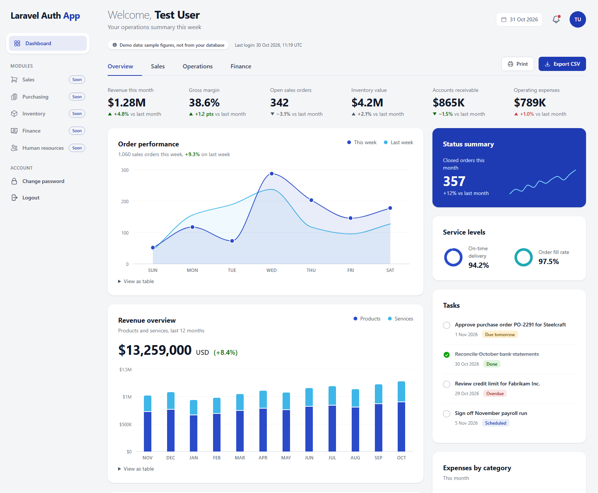

# Laravel Auth App

[](https://www.php.net/)
[](https://laravel.com/)
[](https://tailwindcss.com/)
[](#license)

A Laravel 13 web application with hand-written authentication and an ERP-style operations dashboard. Every controller, form request and view lives in this repository: no starter kit (Breeze, Jetstream or Fortify) is used, so you can read and change how each part works.



## Contents

- [Features](#features)
- [Tech stack](#tech-stack)
- [Prerequisites](#prerequisites)
- [Getting started](#getting-started)
- [Configuring the app](#configuring-the-app)
- [Using the app](#using-the-app)
- [Running the tests](#running-the-tests)
- [Project structure](#project-structure)
- [Routes](#routes)
- [Security](#security)
- [Deploying to production](#deploying-to-production)
- [Troubleshooting](#troubleshooting)
- [Contributing](#contributing)
- [License](#license)

## Features

**Authentication**

- Sign up, log in (with "Remember me") and log out.
- Forgot password and reset password through an emailed link.
- Change password while logged in. Changing it logs you out on your other devices.
- Show/Hide buttons on every password field, and a live "Passwords match" indicator on the sign-up form.
- An Artisan command, `user:create`, for administrators to add users.

**Dashboard**

- A sidebar layout with Overview, Sales, Operations and Finance tabs.
- Six headline figures, each with its change since last month.
- Charts drawn without a chart library: an area chart, stacked columns, a donut, ring gauges and a column chart. Every chart has hover and keyboard tooltips, and the main charts have a "View as table" option.
- Purchase orders, tasks, deadlines, an activity timeline and top performers.
- Print and Export CSV buttons.

> [!NOTE]
> The dashboard shows **sample data**, not data from your database. The page labels it as demo data. See [Replacing the dashboard demo data](#replacing-the-dashboard-demo-data).

## Tech stack

| Layer | Technology |
| --- | --- |
| Backend | PHP 8.3+, Laravel 13 |
| Views | Blade |
| Styling | Tailwind CSS 4, built with Vite. Bootstrap 5 is available for new pages. |
| JavaScript | Plain JavaScript, with no framework |
| Database | MySQL 8 (utf8mb4). The tests use in-memory SQLite. |
| Tests | PHPUnit 12 |

## Prerequisites

Before you begin, install the following:

- **PHP 8.3 or later**, with the `pdo_mysql`, `pdo_sqlite`, `mbstring`, `openssl` and `fileinfo` extensions enabled.
- **Composer 2**.
- **Node.js 20.19+ or 22.12+**, with npm.
- **MySQL 8**, or MySQL 5.7 with the InnoDB engine. MAMP and WAMP both work.

To check your versions, run:

```bash
php -v
composer -V
node -v
```

## Getting started

1. Clone the repository and go to its folder:

   ```bash
   git clone https://github.com/Gusky042/Tutorial-laravel-authentication-system.git
   cd Tutorial-laravel-authentication-system
   ```

1. Install the PHP and JavaScript dependencies:

   ```bash
   composer install
   npm install
   ```

1. Create your environment file and generate an application key:

   ```bash
   cp .env.example .env
   php artisan key:generate
   ```

   In Windows PowerShell, use `Copy-Item .env.example .env` in place of `cp`.

1. Create the database in MySQL:

   ```sql
   CREATE DATABASE laravel_auth_app CHARACTER SET utf8mb4 COLLATE utf8mb4_unicode_ci;
   ```

1. In `.env`, set `DB_PORT`, `DB_USERNAME` and `DB_PASSWORD` for your MySQL server. See [Configuring the app](#configuring-the-app).

1. Create the tables and the test user:

   ```bash
   php artisan migrate --seed
   ```

1. Build the front-end assets and start the development server:

   ```bash
   npm run build
   php artisan serve
   ```

1. Open <http://localhost:8000> and log in with the test user:

   - Email: `test@example.com`
   - Password: `Password123!`

   You see the dashboard.

> [!TIP]
> While you edit views, CSS or JavaScript, run `npm run dev` in a second terminal. The browser then reloads on each change.

## Configuring the app

All settings live in `.env`. Never commit this file. Git already ignores it.

| Variable | Example | Purpose |
| --- | --- | --- |
| `APP_NAME` | `"Laravel Auth App"` | The name in the sidebar, page titles and emails. The last word appears in blue in the sidebar. |
| `APP_URL` | `http://localhost:8000` | The base URL. Password reset links use this value. |
| `DB_HOST` / `DB_PORT` | `127.0.0.1` / `3306` | The MySQL server. MAMP's MySQL usually runs on port `8889` or `3308`. |
| `DB_DATABASE` | `laravel_auth_app` | The database name. |
| `DB_USERNAME` / `DB_PASSWORD` | | Your MySQL credentials. |
| `SESSION_DRIVER` | `database` | Where sessions are stored. |
| `MAIL_MAILER` | `log` | `log` writes emails to `storage/logs/laravel.log`. In production, use `smtp` or a mail service. |

## Using the app

### Creating an account

You can create accounts in two ways:

- **In the browser:** Open <http://localhost:8000/register>, or click **Create an account** on the login page. After you sign up, the app logs you in and opens the dashboard.
- **From the command line:** Run the following command. It asks for a name, an email and a password, and hides the password as you type.

  ```bash
  php artisan user:create
  ```

The app stores emails in lowercase, and each email can have only one account.

### Password rules

A password must have:

- at least 8 characters,
- upper and lower case letters,
- a number,
- a symbol.

In production, the app also rejects passwords that appear in known data breaches. To change the rules, edit `Password::defaults()` in `app/Providers/AppServiceProvider.php`.

### Reading password reset emails locally

With `MAIL_MAILER=log`, the app writes emails to a log file instead of sending them. To reset a password locally:

1. On the login page, click **Forgot your password?** and enter your email.
1. Open `storage/logs/laravel.log`.
1. Copy the `/reset-password/...` link from the latest email into your browser.

### Replacing the dashboard demo data

All dashboard figures come from one class, `app/Support/ErpDemoData.php`. Each section has its own method, for example `kpis()` and `purchaseOrders()`. To show real data, replace a method's hard-coded array with a database query that returns the same shape. The views don't need to change.

### Building pages with Bootstrap

The existing pages use Tailwind CSS. Bootstrap 5 is installed for new pages, and loads only on pages that ask for it, so the two never clash. To build a page with Bootstrap, extend the Bootstrap layout:

```blade
@extends('layouts.bootstrap')

@section('title', 'My page')

@section('content')
    <button class="btn btn-primary">Hello</button>
@endsection
```

The layout shows `session('status')` and `session('error')` as Bootstrap alerts. Bootstrap's JavaScript is available as `window.bootstrap`.

## Running the tests

The tests use an in-memory SQLite database, so they never touch your MySQL data.

```bash
php artisan test
```

All tests pass when the output ends with a line like `Tests: 44 passed`.

## Project structure

```text
app/
├── Console/Commands/CreateUser.php     # php artisan user:create
├── Http/
│   ├── Controllers/Auth/               # Login, register, password reset and change
│   ├── Controllers/DashboardController.php
│   └── Requests/Auth/                  # Validation and login rate limiting
├── Providers/AppServiceProvider.php    # Password rules and reset-link URL
└── Support/ErpDemoData.php             # Dashboard sample data
resources/
├── js/app.js                           # Tooltips, tabs, sidebar, password toggles
└── views/
    ├── layouts/                        # app (sidebar), guest, bootstrap
    ├── components/erp/                 # Dashboard charts and widgets
    ├── auth/                           # Login, register, forgot and reset password
    ├── settings/password.blade.php
    └── dashboard.blade.php
routes/web.php
tests/Feature/                          # Authentication and dashboard tests
```

## Routes

| Method | URI | Name | Middleware |
| --- | --- | --- | --- |
| GET | `/` | – | Redirects to the login page or the dashboard |
| GET | `/login` | `login` | guest |
| POST | `/login` | – | guest; 5 failed attempts per email and IP |
| GET | `/register` | `register` | guest |
| POST | `/register` | `register.store` | guest, throttle:6,1 |
| POST | `/logout` | `logout` | auth, auth.session |
| GET | `/forgot-password` | `password.request` | guest |
| POST | `/forgot-password` | `password.email` | guest, throttle:6,1 |
| GET | `/reset-password/{token}` | `password.reset` | guest |
| POST | `/reset-password` | `password.store` | guest, throttle:6,1 |
| GET | `/settings/password` | `password.edit` | auth, auth.session |
| PUT | `/settings/password` | `password.update` | auth, auth.session, throttle:6,1 |
| GET | `/dashboard` | `dashboard` | auth, auth.session |

## Security

- The app hashes passwords with Laravel's default hasher (bcrypt) and never stores them in plain text.
- Every form has CSRF protection, and logout accepts only `POST`.
- Login locks for a short time after 5 failed attempts for the same email and IP address.
- The forgot-password form shows the same message whether or not the email exists, so it doesn't reveal which emails have accounts.
- Password reset links use `APP_URL`, not the request's host header, which blocks reset-link poisoning.
- After a password change or reset, sessions on other devices end.
- Blade escapes all user-provided text.

To report a security problem, contact the maintainer privately instead of opening a public issue.

## Deploying to production

Before you go live, check each item:

- [ ] Set `APP_ENV=production`, `APP_DEBUG=false` and the real `APP_URL`, starting with `https://`.
- [ ] Use a MySQL user that has access only to this app's database, not `root`.
- [ ] Configure real `MAIL_*` settings, then send yourself a test password reset email.
- [ ] Set `SESSION_SECURE_COOKIE=true`.
- [ ] Run `php artisan migrate --force`.
- [ ] Run `npm run build`.
- [ ] Run `php artisan optimize`, and run it again after every deploy.
- [ ] Make `storage/` and `bootstrap/cache/` writable by the web server.
- [ ] Don't seed the test user. Create real users with `php artisan user:create`.

## Troubleshooting

### `could not find driver` when you migrate or log in
PHP can't load the MySQL driver. In your `php.ini`, enable `extension=pdo_mysql`, then restart the server. To find the active file, run `php --ini`.

### `Specified key was too long; max key length is 1000 bytes`
Your MySQL server uses the MyISAM engine by default, as WAMP does. This project already forces InnoDB in `config/database.php`. If the error still appears, run `php artisan migrate:fresh --seed` to rebuild the tables. This command deletes all existing data.

### The page looks unstyled, or recent changes don't show
Run `npm run build`, then hard-refresh the browser with Ctrl+F5 on Windows or Cmd+Shift+R on macOS.

### `419 Page Expired` after submitting a form
Your session expired, or you opened the app on a different host than `APP_URL`, such as `127.0.0.1` instead of `localhost`. Reload the page and try again.

### The app doesn't run under MAMP's or WAMP's Apache
Laravel 13 needs PHP 8.3 or later. If your Apache uses an older PHP, run the app with `php artisan serve` and use MAMP or WAMP only for MySQL.

## Contributing

1. Create a branch from `main`.
1. Make your change and add or update tests.
1. Run `php artisan test` and `npm run build`. Both must succeed.
1. Open a pull request that describes what changed and why.

## License

This project uses the MIT License, as declared in `composer.json`.
